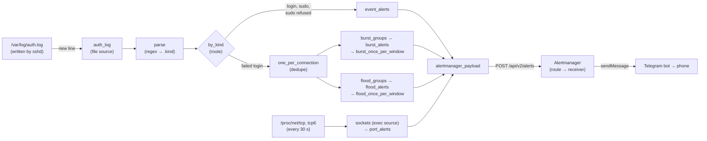

# Guide: how systems-monitoring works

A plain-English walk through the repo, for reading it without help. The
planning docs say *why*; this says *what happens where*.

## What it does, in two sentences

Vector, an open-source log tool, reads the server's login log and its
list of open ports and turns six kinds of security event into alerts.
Alertmanager, Prometheus's alert router, groups those alerts and sends
each one to Arthur's phone through a Telegram bot.

There is no application code here. The work is **configuration** of
those two tools, plus **tests** that prove the configuration does what
the docs say.

## The flow: one SSH login, from log line to phone



Follow one line: `Accepted publickey for deploy from 203.0.113.7 port 51522`.

1. **sshd writes the line** to `/var/log/auth.log` on the server.
2. **The container can see it:** `deploy/compose.yaml`, service `vector`,
   mounts `/var/log` read-only at `/host/log`.
3. **Vector reads the new line:** `deploy/vector/vector.yaml`,
   `sources.auth_log`. It starts at the end of the file, so old lines
   never alert, and it follows the file through log rotation.
4. **The line becomes an event:** `transforms.parse`. A regular
   expression pulls out the program (`sshd`) and the message; a second one
   recognises `Accepted …` and sets `.kind = "login"`, with the user,
   method and address.
5. **Events and failed logins part ways:** `transforms.by_kind`. A login
   goes to `event_alerts`.
6. **The alert is built:** `transforms.event_alerts`. It sets the labels
   (`alertname: SSHLogin`, `severity: page`, the host label, the user, a
   unique `event_id`), checks whether the address is in a known network
   (then `severity: ticket`, a silent message), writes the summary and
   the runbook link, and sets `endsAt` five minutes ahead.
7. **Only Alertmanager's fields leave:** `transforms.alertmanager_payload`.
8. **Vector sends it:** `sinks.to_alertmanager` posts a JSON list of
   alerts to `http://127.0.0.1:9093/api/v2/alerts`. If Alertmanager is
   down, up to 1,000 alerts wait in its buffer and are retried.
9. **Alertmanager picks a receiver:** `deploy/alertmanager/alertmanager.yml`,
   `route`. The alert has an `event_id` and `severity: page`, so it goes
   to `telegram-page-event`. Alertmanager waits 15 s (`group_wait`) in
   case more alerts of the same kind and user arrive, then sends one
   message for the group.
10. **The message is written:** `deploy/alertmanager/templates/telegram.tmpl`,
    `telegram.sm.message`: 🔴, the alert name, the host, each summary, the
    runbook link.
11. **Telegram delivers it:** Alertmanager calls the bot API with the token
    and chat ID from `deploy/secrets/` (never committed).

**The other paths:**
- **A failed login** goes to `one_per_connection`, which drops repeat
  lines about the same connection (address and port). Then
  `burst_groups` collects up to 20 per address, `burst_alerts` keeps a
  group only if it arrived within 60 s, and `burst_once_per_window`
  stops a long attack from alerting more than once a minute. The flood
  path does the same for all addresses: 200 in 10 minutes.
- **A new port:** every 30 s `sources.sockets` prints the kernel's socket
  tables; `transforms.port_alerts` decodes each listening socket's
  address, skips loopback and allowed ports, and alerts on the rest. The
  alert ends 90 s ahead and is re-sent every 30 s while the port is open,
  so it resolves on its own about two minutes after the port closes.

## Glossary

| Term | Meaning | Where |
|---|---|---|
| **Alertmanager** | Prometheus's alert router: receives alerts, groups them, silences them, sends them to receivers | `deploy/alertmanager/` |
| **Vector** | An open-source pipeline for logs and events (by Datadog). Here it does the detecting | `deploy/vector/vector.yaml` |
| **Source, transform, sink** | Vector's three kinds of component: where events come from, what changes them, where they go | `sources:`, `transforms:`, `sinks:` |
| **VRL** | Vector Remap Language: the small language inside each `remap` transform | the `source: \|` blocks |
| **Route** (Vector) | A transform that splits events by a condition | `by_kind` |
| **Dedupe, reduce, throttle** | Vector transforms: drop repeats; collect events into groups; let only N through per time window | `one_per_connection`, `*_groups`, `*_once_per_window` |
| **Route, receiver** (Alertmanager) | The tree of rules that picks where an alert goes; the destination itself | `route:`, `receivers:` |
| **group_wait, group_interval** | How long Alertmanager waits to gather alerts into one message, and how often it sends updates for a group | `alertmanager.yml` |
| **Page, ticket** | The two severities: a page buzzes the phone; a ticket arrives silently | the `severity` label |
| **Event, state** | An event happens once (a login) and ends by itself after 5 minutes; a state stays true until it isn't (a port open) and gets a "Resolved" message | the `event_id` label marks events |
| **endsAt** | When Alertmanager should treat an alert as over unless it's sent again | set in each `*_alerts` transform |
| **Runbook** | What an alert means and what to do about it, one per alert | `docs/runbooks/` |
| **Known network** | Addresses whose SSH logins arrive silently (your own) | `SECURITY_KNOWN_NETWORKS` |
| **Allow-list** | Ports that are expected to listen publicly | `SECURITY_ALLOWED_PORTS` |
| **Loopback** | `127.0.0.1` and `::1`: reachable only from the server itself, so ignored | `port_alerts` |
| **/proc/net/tcp** | The kernel's table of TCP sockets; state `0A` means listening | `sources.sockets` |
| **preauth** | sshd's tag for a connection that closed before logging in | `parse` |
| **sshd-session** | The name OpenSSH 9.8 and later log under, instead of `sshd` | `parse` |
| **amtool** | Alertmanager's command-line tool: check the config, test routes, send or silence alerts | the runbooks, `e2e/test_routes.py` |
| **Telegram stand-in** | A tiny fake of Telegram's API, so tests deliver messages without the internet | `e2e/telegram_stub.py` |
| **Mutation check** | Breaking the code on purpose to prove a test notices | described in the README |
| **SLO, error budget, burn rate** | A reliability target, how much failure it allows, and how fast that allowance is being spent (later slices) | `docs/planning/phase-5-architecture-decisions.md`, ADR-008 |
| **Digest pinning** | Naming a Docker image by its content hash, so it can't change underneath us | `image: …@sha256:…` |
| **mem_limit, read_only, cap_drop** | Container limits: a hard memory cap, no writes to its own files, no Linux privileges | `deploy/compose.yaml` |

## Where to change things

| To… | Edit | Then |
|---|---|---|
| Allow a new public port | `SECURITY_ALLOWED_PORTS` in `deploy/.env` (on the server) | `docker compose up -d vector` |
| Make your own logins silent | `SECURITY_KNOWN_NETWORKS` in `deploy/.env` | `docker compose up -d vector` |
| Change the burst or flood thresholds | `deploy/vector/vector.yaml`: `max_events` in `burst_groups` / `flood_groups` **and** `threshold` in `burst_alerts` / `flood_alerts` (keep them equal) | Update the tests in `deploy/vector/tests/rules.yaml` and the runbook |
| Change a message's wording | The summary in the matching `*_alerts` transform | Update its test in `rules.yaml` and `e2e/test_e2e.py` |
| Change how messages look | `deploy/alertmanager/templates/telegram.tmpl` | Run the e2e tests |
| Change who gets what, or how loud | `route:` and `receivers:` in `deploy/alertmanager/alertmanager.yml` | Update `e2e/test_routes.py` |
| Add a new rule | A branch in `parse` (if it's a new line shape) and a `*_alerts` transform in `vector.yaml`; a test in `rules.yaml`; a runbook in `docs/runbooks/` and a row in its README; an end-to-end test | `tests/test_runbooks.py` fails until the runbook exists |
| Silence alerts during maintenance | Nothing: `amtool silence add …` (in `docs/runbook-deploy.md`) | — |
| Update an image | The tag and digest in `deploy/compose.yaml`, on a branch | Run all tests |

## Running the tests

```bash
uv sync
uv run ruff check . && uv run pyright && uv run pytest   # quick: runbook coverage
uv run pytest -m e2e e2e/                                # Docker: rules, routing, end to end
```

- `e2e/test_vector_rules.py` runs `vector test` on `deploy/vector/tests/rules.yaml`:
  one test per rule, named as a sentence.
- `e2e/test_routes.py` asks `amtool` where each kind of alert goes.
- `e2e/test_e2e.py` starts the real compose file with the Telegram
  stand-in, writes log lines and socket tables, and waits for each
  message.
